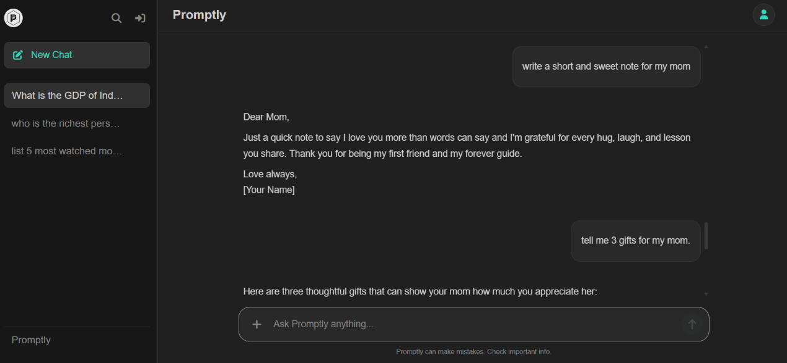
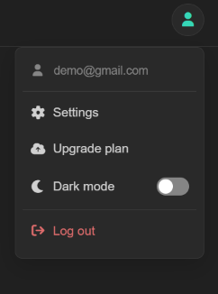

# 🤖 Promptly

> **Think. Ask. Explore.**

A full-stack AI chat application that lets users interact with AI, manage multiple conversations, and revisit their chat history. Built with React, Node.js, Express, MongoDB, and the Groq API.

## 🌐 Live Demo

🔗 **[Visit Promptly](https://promptly-o4kj.onrender.com)**

---

## ✨ Features

- 🤖 **AI Conversations** — Get AI-generated responses powered by the Groq API.
- 🔐 **User Authentication** — Signup, login, logout, and protected routes.
- 💬 **Multiple Conversations** — Start and manage separate chat threads.
- 🕘 **Chat History** — Conversations are stored and available for later access.
- 🗑️ **Conversation Management** — Delete existing conversations.
- 🌓 **Theme Toggle** — Switch between light and dark modes.
- 📱 **Responsive Interface** — Chat interface designed for different screen sizes.
- ☁️ **Deployment** — Deployed on Render with MongoDB Atlas.

---

## 📸 Screenshots

### 💬 Chat Interface




### 🌓 Theme Modes



---

## 🛠️ Tech Stack

**Frontend:** React · Vite · CSS

**Backend:** Node.js · Express.js

**Database:** MongoDB · Mongoose · MongoDB Atlas

**AI Integration:** Groq API · OpenAI-compatible SDK

**Authentication:** Passport.js · Express Session

**Deployment:** Render

---

## 📂 Project Structure

```text
Promptly/
├── frontend/
│   ├── src/
│   ├── public/
│   ├── index.html
│   └── package.json
│
├── backend/
│   ├── models/
│   ├── routes/
│   ├── middleware/
│   ├── utils/
│   ├── server.js
│   └── package.json
│
└── README.md
```

---

## 🚀 Run Locally

### 1. Clone the repository

```bash
git clone https://github.com/akshra-s/Promptly.git
cd Promptly
```

### 2. Install dependencies

```bash
npm install --prefix frontend
npm install --prefix backend
```

### 3. Configure environment variables

Create a `.env` file inside the `backend` directory:

```env
GROQ_API_KEY=your_groq_api_key
MONGODB_URI=your_mongodb_connection_string
SESSION_SECRET=your_session_secret
FRONTEND_URL=http://localhost:5173
```

### 4. Start the backend

```bash
cd backend
npm run dev
```

### 5. Start the frontend

Open another terminal:

```bash
cd frontend
npm run dev
```

Open the local URL provided by Vite in your browser.

---

## 🎯 Project Highlights

```text
React Frontend
      ↓
Express Backend
      ↓
Authentication & Session Management
      ↓
Groq API ─── AI Responses
      ↓
MongoDB ─── Conversations & Messages
```

Built to practice **full-stack development, REST APIs, AI integration, authentication, session management, database relationships, and deployment.**

---

## 🔮 Future Plans

- 📎 File and image attachment support
- 🧠 Improved conversation context
- ✏️ Rename conversations
- ⚡ Streaming AI responses
- 🛡️ Rate limiting and additional security improvements

---

## 👩‍💻 Author

**Akshra Srivastava**  
B.Tech IT — BPIT, Delhi

⭐ **If you find Promptly useful, consider giving the repository a star!**

**Repository:** [github.com/akshra-s/Promptly](https://github.com/akshra-s/Promptly)
